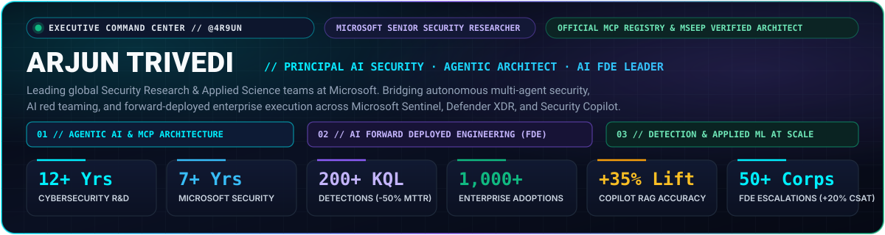
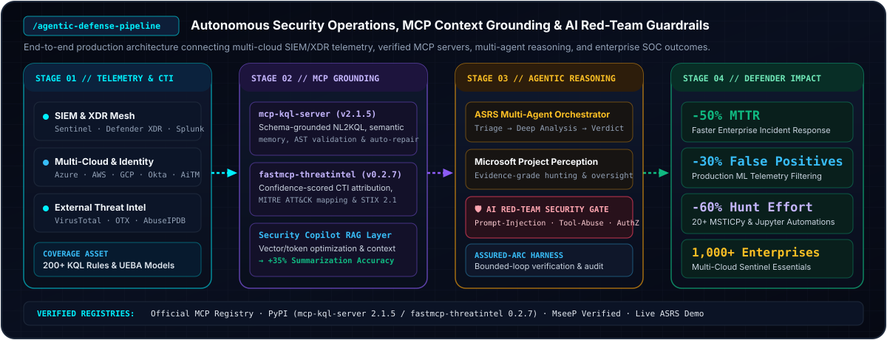
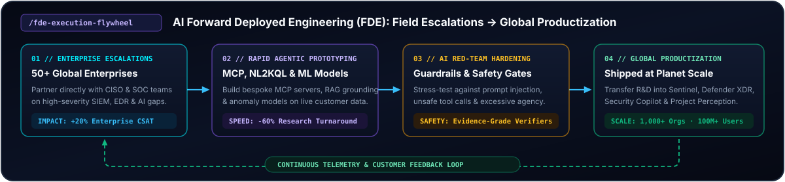

<div align="center">

<a href="https://4r9un.github.io">
  
</a>

<br/>

[](https://4r9un.github.io)
[](https://asrs-demo-v1.vercel.app/)
[](https://www.linkedin.com/in/imarjuntrivedi/)
[](https://registry.modelcontextprotocol.io/?q=4R9UN)
[](https://pypi.org/user/Arjun_Trivedi/)
[](https://arjuntrivedi.substack.com)
[](mailto:arjuntrivedi42@yahoo.com)

</div>

---

## ⚡ Executive Summary

<table>
<tr>
<td width="160" align="center" valign="middle">
  <a href="https://4r9un.github.io">
    
  </a>
  <br/>
  <sub><b>Arjun Trivedi</b><br/><code>@4R9UN</code></sub>
</td>
<td valign="middle">

**Executive Security Research, Applied Science & Agentic AI Leader** with **12+ years** in cybersecurity and **7+ years at Microsoft**. I lead global **Security Research & Applied Science teams** at Microsoft—combining executive people leadership, organizational strategy, and mentorship with deep hands-on technical architecture to invent and ship breakthrough **Agentic AI**, **Production MCP Servers**, **Vibe Research Platforms**, and autonomous defense solutions across product engineering, data science, SOC operations, and enterprise customers.

My work sits at the intersection of **Autonomous Security Agents (MCP / Multi-Agent Reasoning)**, **AI Red Teaming & Guardrails**, **Forward-Deployed Enterprise Execution (FDE)**, and **Planet-Scale Detection Engineering & Applied ML**—turning complex nation-state, multi-cloud, and AI security challenges into shipped Microsoft capabilities (**Project Perception**, **Security Copilot**) protecting **1,000+ enterprises** and **100M+ users across 150 countries**.

</td>
</tr>
</table>

---

## 🧠 Architecture Blueprint: Autonomous Agentic Defense & MCP Pipeline

<div align="center">
  
</div>

### ⚡ Run This Agentic Security & MCP Stack in 60 Seconds

Every stage in the architecture diagram above maps directly to shipped, open-source repositories in this GitHub profile, verified PyPI packages, and live sandboxes:

#### 1️⃣ Stage 1 & 2 — Install Schema-Grounded NL2KQL & Threat-Intel MCP Servers
```bash
pip install mcp-kql-server fastmcp-threatintel
```
Add both verified MCP servers to your **Claude Desktop**, **GitHub Copilot CLI**, **Cursor**, or **VS Code** `mcp-config.json`:
```json
{
  "mcpServers": {
    "kql-sentinel": {
      "command": "python",
      "args": ["-m", "mcp_kql_server"],
      "env": { "AZURE_CORE_ONLY_SHOW_ERRORS": "true" }
    },
    "threatintel-cti": {
      "command": "fastmcp-threatintel",
      "env": {
        "VIRUSTOTAL_API_KEY": "YOUR_VT_KEY",
        "OTX_API_KEY": "YOUR_OTX_KEY",
        "ABUSEIPDB_API_KEY": "YOUR_ABUSE_KEY"
      }
    }
  }
}
```
- **Repositories:** [`4R9UN/mcp-kql-server`](https://github.com/4R9UN/mcp-kql-server) (`PyPI v2.1.5` · Official MCP Registry) · [`4R9UN/fastmcp-threatintel`](https://github.com/4R9UN/fastmcp-threatintel) (`PyPI v0.2.7` · ★ 40) · [`4R9UN/Multi-Cloud-Notebooks`](https://github.com/4R9UN/Multi-Cloud-Notebooks) (`1,000+` Sentinel enterprise deployments)

#### 2️⃣ Stage 3 — Multi-SIEM Autonomous Investigation (`ASRS`) & Bounded Agent Harness (`Assured-Arc`)
- **Launch Live Multi-SIEM Agent Sandbox:** [**`https://asrs-demo-v1.vercel.app/`**](https://asrs-demo-v1.vercel.app/) ([`4R9UN/ASRS-demo`](https://github.com/4R9UN/ASRS-demo))
- **Install `Assured-Arc` Multi-Agent Security Harness for GitHub Copilot:**
```powershell
git clone https://github.com/4R9UN/Assured-Arc.git
pwsh -File .\Assured-Arc\scripts\install.ps1 -Profile full -Target both
```

---

## 🏛️ Three Signature Leadership Pillars

<table>
<tr>
<td width="33%" valign="top">

### 01 // Agentic AI & AI Security Architecture
- **Microsoft Project Perception:** Contributed research and threat-hunting agent capabilities applying organizational context, detection intelligence, and evidence-grade reasoning with human oversight.
- **Microsoft Security Copilot (+35% Accuracy):** Engineered retrieval-augmented threat summarization and optimized context, token, and vector grounding to lift reported analyst accuracy by **35%**.
- **AI Red Teaming & Guardrails:** Lead hands-on assessments for prompt injection, jailbreaks, unsafe tool invocation, authorization boundary failures, indirect instruction attacks, and excessive agency.
- **Official MCP Ecosystem:** Creator of Official MCP Registry & MseeP-verified servers (`mcp-kql-server` v2.1.5, `fastmcp-threatintel` v0.2.7), `ASRS`, and `Assured-Arc`.

</td>
<td width="33%" valign="top">

### 02 // AI Forward Deployed Engineering (FDE)
- **50+ Global Enterprise Escalations (+20% CSAT):** Partner directly with enterprise CISO & SOC teams to resolve critical SIEM, EDR/XDR, and AI security bottlenecks, converting customer field evidence into product roadmap priorities.
- **1,000+ Enterprise Adoptions:** Co-created and shipped **Multi Cloud Attack Coverage Essentials** for Microsoft Sentinel, translating cross-cloud threat research into deployable analytics.
- **R&D-to-Production Transfer:** Direct proof-of-concept architecture and production handoff across **Microsoft Sentinel**, **Defender XDR**, and **Security Copilot**.
- **Pioneer — Microsoft Threat Experts:** Helped design and operationalize Microsoft's on-demand expert response service for human-operated attacks; led the Tier-1 hunting team.

</td>
<td width="33%" valign="top">

### 03 // Detection Engineering & Applied ML at Scale
- **200+ KQL Detections (-50% MTTR):** Architected cross-domain detections and correlation rules across Sentinel & Defender XDR covering identity threats, AiTM phishing, UEBA, cloud abuse, and advanced persistence.
- **Production ML Models (-30% False Positives):** Developed and validated Random Forest, Gradient Boosting, Isolation Forest, and One-Class SVM models on high-volume security telemetry.
- **Blue-Team Automation (-60% Effort):** Built **20+ Python, Jupyter & MSTICPy** automation assets for hunting, enrichment, and YARA generation.
- **Deep Reverse Engineering Roots:** Former Malware Analyst (Wipro) & Threat Researcher (Sophos) protecting **100M+ users across 150 countries**.

</td>
</tr>
</table>

---

## 🔄 AI Forward Deployed Engineering (FDE) Execution Flywheel

<div align="center">
  
</div>

---

## 🚀 Flagship Production Systems & Open-Source Arsenal

| System / Repository | Category & Verification | Architecture & Measurable Capabilities | Links |
| :--- | :--- | :--- | :--- |
| **[ASRS — Autonomous Security Reasoning System](https://github.com/4R9UN/ASRS-demo)** | `Multi-Agent SIEM` · `TypeScript` · `MCP` | Unified autonomous investigation platform spanning **Microsoft Sentinel, Splunk, Elastic Security & CrowdStrike Falcon**. Specialized **Triage**, **Deep Analysis**, and **Verdict** agents correlate alerts, entities, evidence timelines, confidence scores, and MITRE ATT&CK mappings. | [🔴 **Live Demo**](https://asrs-demo-v1.vercel.app/) · [Repo](https://github.com/4R9UN/ASRS-demo) |
| **[mcp-kql-server](https://github.com/4R9UN/mcp-kql-server)** | `PyPI v2.1.5` · `Official MCP Registry` · `MseeP Verified` | Production MCP server for **schema-grounded NL2KQL**, strict query validation & auto-repair, semantic schema memory, secure Kusto execution, visual analysis, and **Azure Container Apps** deployment via Managed Identity & Bicep IaC. | [📦 **PyPI**](https://pypi.org/project/mcp-kql-server/) · [Repo](https://github.com/4R9UN/mcp-kql-server) |
| **[fastmcp-threatintel](https://github.com/4R9UN/fastmcp-threatintel)** | `PyPI v0.2.7` · `MseeP Verified` · `40★ / 14 Forks` | AI-ready threat intelligence MCP server integrating **VirusTotal, AlienVault OTX, AbuseIPDB & IPinfo** with confidence-scored attribution, MITRE ATT&CK mapping, IOC graph relationships, D3.js visualization, and STIX output. | [📦 **PyPI**](https://pypi.org/project/fastmcp-threatintel/) · [Repo](https://github.com/4R9UN/fastmcp-threatintel) |
| **[Assured-Arc](https://github.com/4R9UN/Assured-Arc)** | `Multi-Agent Harness` · `GitHub Copilot` · `AI Safety` | Portable multi-agent engineering harness for bounded agent loops, deterministic skill routing, context-isolated disposable subagents, least-privilege MCP safety gates, and automated verification. | [🛡️ **Explore Harness**](https://github.com/4R9UN/Assured-Arc) |
| **[Multi-Cloud Attack Coverage & Notebooks](https://github.com/4R9UN/Multi-Cloud-Notebooks)** | `1,000+ Enterprises` · `Sentinel` · `Jupyter / KQL` | Cross-cloud detection engineering and hunting notebooks across **Azure, AWS, GCP & Okta**; foundation for Microsoft Sentinel's **Multi Cloud Attack Coverage Essentials** solution (`1,000+` enterprise deployments). | [☁️ **Notebooks**](https://github.com/4R9UN/Multi-Cloud-Notebooks) · [Tech Community](https://techcommunity.microsoft.com/blog/microsoftsentinelblog/what%E2%80%99s-new-multi-cloud-attack-coverage-essentials-solution/3839784) |
| **[Prompt-Book](https://github.com/4R9UN/Prompt-Book)** | `Privacy-First AI Workspace` · `TypeScript` | Structured prompt-engineering workbench for repeatable security investigation workflows, adversarial red-team test cases, and agent prompt evaluation. | [📓 **Repo**](https://github.com/4R9UN/Prompt-Book) |

---

## 🏆 Recognition, Media & Thought Leadership

- 🥇 **Winner — Microsoft Global Hackathon 2023** (*MSTICPy AI Assistant*); also served as **Hackathon Judge** and **Microsoft Security Hackathon 2025** innovator.
- 🎙️ **Featured Guest — [AZ Security Podcast (Episode 27)](https://www.youtube.com/watch?v=c8g4b7_1vXo):** Deep dive into `mcp-kql-server`, schema-grounded NL2KQL, advanced threat hunting, and AI-enabled SOC automation.
- 📰 **Author — [MCP KQL Server Newsletter](https://arjuntrivedi.substack.com) (`1,900+` Subscribers) & `15+` Technical Publications:** Published across [Microsoft Tech Community](https://techcommunity.microsoft.com/users/arjun_trivedi/1208210) and [Arjun's Cyber Insights](https://arjun-trivedi.blogspot.com/), covering practical risks in cybersecurity agents, multi-cloud detections, and agentic defense.
- 👨‍🏫 **Executive Mentorship & Community Builder:** Mentored **50+ security engineers and researchers** globally across detection engineering, AI security, and threat hunting.

---

## 💼 Career Trajectory & Education

- **Microsoft — Senior Security Researcher | Detection Engineering & AI Security** (`Aug 2020 – Present`, Hyderabad, India): Leads global Security Research & Applied Science teams; Project Perception hunting agents; Security Copilot RAG grounding (`+35%` accuracy); AI Red Teaming; Applied ML (`-30%` FP); `200+` KQL rules (`-50%` MTTR); Multi Cloud Attack Coverage Essentials (`1,000+` enterprises); `50+` enterprise FDE escalations (`+20%` CSAT).
- **Microsoft — Cyber Threat Hunter | Microsoft Threat Experts** (`Mar 2019 – Aug 2020`, India): Pioneer member of Microsoft Threat Experts on-demand service; Tier-1 hunting SME lead; cross-platform ML IOC detection pipelines & RE quality governance.
- **Wipro — Malware Analyst** (`Jun 2017 – Feb 2019`, India): Android APK & native library reverse engineering (`IDA Pro`, `Ghidra`); PE/non-PE behavioral sandboxes; threat intelligence white papers.
- **Sophos — Threat Researcher** (`Sep 2014 – May 2017`, India): Static/dynamic reverse engineering of bots, worms, ransomware & packed executables; behavioral detections protecting `100M+` users across `150` countries.
- **Early Technical Foundations:** Confidential Government Defense Malware-Detection R&D Project (Python automation & exploit PoCs) + Cybersecurity & Programming Instructor.
- **Education & Certifications:** **M.Sc. in Information Technology** (Amity University, `2015–2017`) · **B.Sc. in Computer Science (IT)** (K.R. Doshi Group of CS College, M.K. Bhavnagar University, `2013–2015`) · **SANS FOR578: Cyber Threat Intelligence** · **Microsoft SkillUp AI: Applied AI & Responsible AI Development** · **Cyber Security & Ethical Hacking** (Appin Technologies).

---

## 🛠️ Executive & Technical Stack

| Domain | Capabilities & Technologies |
| :--- | :--- |
| **Agentic AI & AI Security** | Multi-Agent Systems · Model Context Protocol (`MCP` / `FastMCP`) · RAG & Vector Grounding · `NL2KQL` · Agent Evaluation · AI Red Teaming (Prompt Injection, Jailbreaks, Tool Abuse, AuthZ Boundaries, Excessive Agency) |
| **Detection & Threat Research** | Microsoft Sentinel · Microsoft Defender XDR · `KQL` (200+ production rules) · UEBA · Identity & AiTM Detection · MITRE ATT&CK · Nation-State Campaign Tracking · Malware Reverse Engineering (`IDA Pro`, `Ghidra`) |
| **Applied ML & Automation** | `Python` · `MSTICPy` · `Jupyter` · Random Forest · Gradient Boosting · Isolation Forest · One-Class SVM · YARA · STIX 2.1 |
| **Cloud & Production Infra** | `Azure` · `AWS` · `GCP` · `Okta` · `Splunk` · `Elastic Security` · `Azure Data Explorer (Kusto)` · `TypeScript` · `FastAPI` · `Docker` · `Azure Container Apps` · `Bicep IaC` · Managed Identity |
| **Executive Leadership** | Global Security Research & Applied Science Org Leadership · Technical Strategy & Roadmap Ownership · Vibe Research Platform Architecture · AI Forward Deployed Engineering (50+ Enterprises) · Research-to-Product Transfer |

---

<div align="center">

### 🤝 Open to Executive & Principal Leadership Conversations
**Target Mandates:** `Principal / Director of AI Security` · `Head of Detection Engineering & Threat Research` · `AI Forward Deployed Engineering (FDE) Leader` · `Principal Security Architect (Agentic AI)`

[](https://4r9un.github.io)
[](https://www.linkedin.com/in/imarjuntrivedi/)
[](mailto:arjuntrivedi42@yahoo.com)

</div>
